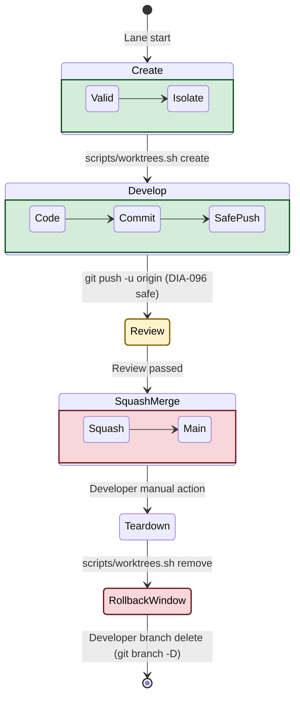

# Architecture: Dev-Infra (Parallel Dev Model)

Status: Retrospective (Implemented via DIA-100)
Parent: ../architecture.md
Decision Sources:

- DIA-073 (Developer decision 2026-08-09: worktrees-only model)
- DIA-096 (Developer decision 2026-08-11: safe vs destructive git operations)
- Commits: a387f72, 44865c3, 8cd270d

## Purpose

This document defines the architectural boundaries and operational mechanics of the "parallel dev model" for the dev-infra module. It governs how parallel OpenCode lanes operate concurrently within the repository, focusing on isolation, branch lifecycle, conflict resolution, and the physical safety constraints enforcing the DIA-096 git policy.

## Architectural Decisions (ADRs)

### ADR 1: Worktrees-Only Parallel Dev Model

- **Status:** Accepted (DIA-073 option d)
- **Context:** Parallel OpenCode sessions running in the same directory clobber shared state (like the single `.opencode/session/current-handoff.json` file), resulting in a last-writer-wins race condition.
- **Decision:** We use git worktrees for true parallel development. Each lane gets a completely independent working directory.
- **Consequences:** Eliminates the need for handoff file coordination protocols or locking mechanisms. Adds minimal disk overhead per lane.
- **Alternatives Considered:** Per-session handoff files, owner-field lock protocols, and registry-based pointers were rejected as over-engineering for a convenience file.

### ADR 2: Branch Naming Convention (DIA-074)

- **Status:** Accepted
- **Context:** Lanes create branches automatically. Without strict naming, the origin repository becomes polluted with unidentifiable AI-generated branch names.
- **Decision:** All lane-created feature branches must adhere strictly to `feature/<ticket>-<short-name>`. The stem must contain only alphanumeric characters, dots, underscores, or hyphens.
- **Consequences:** Ensures human readability and clear ticket traceability for every branch.
- **Alternatives Considered:** Using the generic worktree skill default `omos/<slug>` was rejected in favor of the explicit `feature/` convention.

### ADR 3: Squash-Merge Integration Strategy

- **Status:** Accepted
- **Context:** Parallel lanes produce numerous small, iterative commits. Merging these directly pollutes the main branch history.
- **Decision:** Code produced by lanes must be integrated into `main` via squash-merge after code review.
- **Consequences:** Keeps `main` linear and readable (one commit per ticket).
- **Alternatives Considered:** Rebase-merging was rejected because rebasing against a moving `main` requires a force-push, and force-pushes are strictly denied to lanes under DIA-096.

### ADR 4: Session Isolation via Physical Directories

- **Status:** Accepted
- **Context:** OpenCode needs isolated runtime states.
- **Decision:** Each worktree automatically provisions its own physical, git-ignored `.opencode/session/` directory. The creation script explicitly verifies this directory is not a symlink back to the primary checkout.
- **Consequences:** Lanes operate blindly to one another. There is zero state leakage.
- **Alternatives Considered:** Relying on process-level separation without physical directory isolation.

### ADR 5: DIA-096 Safe/Destructive Boundary Enforcement

- **Status:** Accepted
- **Context:** The OpenCode permission config globally restricts destructive git commands, but `git worktree remove --force` is not globally blocked by the config, creating a bypass vector for deleting dirty working state.
- **Decision:** The lifecycle CLI (`scripts/worktrees.sh`) enforces policy physically. `remove --force` explicitly requires the `WORKTREES_FORCE=1` environment variable, which lanes are not permitted to set.
- **Consequences:** Pushes policy enforcement to the shell script boundary, keeping OpenCode permission config uncluttered. Ensures a dirty worktree must be handed off to the developer.
- **Alternatives Considered:** Adding `git worktree remove --force` to the OpenCode JSON config deny list. Rejected to keep the CLI tools strictly self-policing.

### ADR 6: Conflict Escalation Criteria

- **Status:** Accepted
- **Context:** When lanes pull `main` into their feature branch, they may encounter merge conflicts. Infinite agent loops occur if they cannot resolve complex domain conflicts.
- **Decision:** A strict deterministic bounds policy: Lanes may resolve simple conflicts if they are confined to lane-owned hunks, have no semantic overlap, are 3 hunks or fewer, and both sides are clearly understood. Otherwise (e.g., generated artifacts, lockfiles, domain overlaps), the lane must escalate to the developer.
- **Consequences:** Prevents AI agents from hallucinating arbitrary conflict resolutions that break domain rules or derived artifacts.

### ADR 7: Worktree Location Deviation

- **Status:** Accepted
- **Context:** The generic worktrees skill defaults to `.slim/worktrees/`.
- **Decision:** We place worktrees in `.worktrees/` at the repository root. Branch slashes are mapped to dashes (e.g., `.worktrees/feature-DIA-100-name`).
- **Consequences:** Keeps paths flat and predictable at the repository root.

### ADR 8: Bash-3 Compatibility and Bounded Remote Checks

- **Status:** Accepted
- **Context:** Infrastructure scripts should be portable and resilient to network partitions.
- **Decision:** `worktrees.sh` uses strictly bash-3 compatible syntax. Remote branch collision checks during creation use a 5-second `timeout git ls-remote`.
- **Consequences:** Aligns with `session-log` constraints. Ensures an unreachable origin server does not block a local lane creation for minutes.

### ADR 9: Worktree husky shim materialization (copy, not install)

- **Status:** Accepted
- **Context:** DIA-174 S1: fresh git worktrees lack `.husky/_`, so the husky pre-commit hook (and with it the DIA-094 docker-container gate) is silently not enforced on worktree commits.
- **Decision:** `scripts/worktrees.sh create` COPIES `.husky/_` from the main tree into each new worktree at create time (filesystem-only operation; NOT `husky install`, NOT a symlink).
- **Consequences:** Deterministic, filesystem-only shim materialization with no `core.hooksPath` side effects; keeps each worktree isolated from the main tree's husky runtime; fails loudly when the main tree lacks `.husky/_` (no silent bypass of DIA-094).
- **Alternatives Considered:** `husky install` - rejected (mutates `.git/config`, cross-worktree side effects, husky binary required on PATH); symlink - rejected (breaks the worktree-isolation invariant and breaks on worktree moves).

### ADR 10: Batch-D behavioral suite persistence (committed, wired into test-config)

- **Status:** Accepted
- **Context:** DIA-174 S2 (design.md DD2) made `scripts/__tests__/batch-d-infra.test.mjs` gitignored by design ("session-local reconstruction" of the DIA-172 throwaway suite; absence fails `make test-config` loudly). Review of the 2-day commit window (DIA-176) found the fresh-clone gate break: a fresh clone lacks the file entirely, so `make test-config` hard-fails before any work can be validated - the gitignore rationale did not hold because the suite asserts committed files only (plugin classification outcomes, config grep checks, .sdd ADR structure), none of it session-local.
- **Decision:** The suite is UN-GITIGNORED and committed (DIA-176 F2), remaining wired into `make test-config` as the single entry point for batch-D infra invariants. Regeneration is by the maintainers when the plugin/config invariants it asserts evolve (documented in the file header + Makefile comment).
- **Consequences:** Fresh clones can run the full config gate without re-materialization; the suite ships with the repo and its drift is caught by the assertions themselves. Supersedes design.md DD2's "gitignored, recreate per session" decision.
- **Alternatives Considered:** Keep gitignored + add a Makefile existence check (rejected: silently skips the suite on fresh clone, weakening the gate); keep the suite in /tmp (rejected - the DIA-172 problem this suite was created to fix).

### ADR 11: Container Topology, Single-Authority Runtime Pinning, and Parallel V2 Service

- **Status:** Accepted (Amended 2026-11-19 via DIA-261112-exon; supersedes the single-dev-service and 4-pair static `.mise.toml` `opencode` parity clauses of 2026-09-22 ADR 11 while retaining the single stateful `postgres` boundary)
- **Context:** Two developer workflows share one repository: (a) Linux-in-container (`make opencode` / `docker compose exec`), and (b) Windows/WSL-host (uses the container as the `postgres` host and DIA-094 test/lint executor). The 2026-09-22 revision of ADR 11 consolidated the runtime into one `dev` service (`docker-compose.yml:29-84`, built from `Dockerfile.dev`) plus one stateful `postgres` service (`docker-compose.yml:85-109`, volume `pgdata` at `docker-compose.yml:97,123`), and froze a 4-pair static parity check between `.mise.toml` and `Dockerfile.dev` (`scripts/check-pin-sync.sh:1-104`). Measured baseline on 2026-11-13 inside `poetry-dev` exposed two architectural flaws in that contract:
  1. **Dual-pin shadowing and inert image ARG:** inside `poetry-dev`, OpenCode resolves through the mise shim at `/usr/local/bin/opencode` to `1.18.32` (`.mise.toml:12`), while `@opencode/cli` is not installed globally and `Dockerfile.dev:279-280` carries a malformed install line (`+    opencode --version`), leaving `Dockerfile.dev:30` (`ARG OPENCODE_VERSION=2.2.6`) inert at runtime. Because `scripts/check-pin-sync.sh:102` only compares static strings across `.mise.toml:12` and `Dockerfile.dev:30` - two pins of which only one is live - the parity gate proves nothing about the running binary.
  2. **Cross-major incompatibility requires side-by-side operation:** OpenCode V2 breaks the V1 plugin API and server schema (`knowledge/res-261112-1ima-opencode-version-migration/res-261112-1ima-opencode-version-migration-conspect.md:175-258,438-442`) and V1 cannot read V2-converted config (`:512-514`). An in-place container cutover halts day-to-day V1 development until V2 is complete, whereas sharing named volumes between V1 and V2 services corrupts caches and state.
- **Decision:**
  1. **One install authority per runtime, verified against the live binary:** Each container service has exactly one OpenCode install authority baked into its image layer (`Dockerfile.dev:30,275-280`); `.mise.toml` must not install or shim `opencode` inside the container. Every image build (`Dockerfile.dev:279-280`) AND container startup / runtime check (`dev-entrypoint.sh`) must assert that the resolved `opencode --version` matches the service's declared `ARG OPENCODE_VERSION`.
  2. **Parallel V2 compose service (`dev-v2`) alongside V1 (`dev`):** During the V1-to-V2 migration window, `docker-compose.yml` defines a second workstation service (`dev-v2`) running OpenCode V2 side by side with the existing V1 `dev` service (`docker-compose.yml:29-84`), both connected to `postgres` on `poetry-net` (`docker-compose.yml:83,108,128-130`). Day-to-day engineering continues uninterrupted on the V1 `dev` service; cutover and retirement of the V1 service happen only after the V2 service passes all runtime, plugin, and agent-permission gates.
  3. **Strict volume and cache isolation between V1 and V2 services:** The parallel V2 service MUST use its own image tag (distinct from `poetry-platform-dev:latest` at `docker-compose.yml:39`), its own container/hostname, its own OpenCode and OMO pins (`Dockerfile.dev:30,33`), and dedicated named volumes. The following paths MUST NOT be shared between V1 `dev` and V2 `dev-v2`:
     - `/home/dev/.cache` (mounted from `dev_cache` in V1 at `docker-compose.yml:55,126`, pre-populated at `Dockerfile.dev:293-299`, chowned at `dev-entrypoint.sh:82`): holds `/home/dev/.cache/opencode/node_modules`, where OpenCode caches `oh-my-opencode-slim` and its transitive plugin SDK (`@opencode-ai/plugin` in V1 vs `@opencode/plugin` in V2). Sharing `/home/dev/.cache` causes the V2 service to load a cached V1 OMO build (or overwrites V1's 2.2.19 cache with 3.0.7).
     - `/home/dev/.local/share` (mounted from `dev_state` in V1 at `docker-compose.yml:54,125`, chowned at `dev-entrypoint.sh:80`) and `/home/dev/.local/state/opencode` (`Dockerfile.dev:298`, `dev-entrypoint.sh:81`): hold OpenCode's SQLite database (`ctx.storage` KV rows, saved permission approvals, session state) and lock files, whose V1 and V2 schemas are incompatible.
     - `/usr/local/bin/opencode` and any mise shim directory: each service must resolve its own image-baked binary on `PATH` with zero cross-service shim shadowing.
  4. **Meaningful live-pin parity gate (`scripts/check-pin-sync.sh`):** The parity gate must never degrade into a tautology. Shared language-toolchain pins (`node`, `pnpm`, `bun` in `.mise.toml:10,11,13` and `Dockerfile.dev:25,34,35`) retain static parity via `scripts/check-pin-sync.sh:100,101,103`. For OpenCode and OMO, the gate compares the declared LIVE pin per service (V1 service pin vs V2 service pin while both services exist, collapsing to the single V2 service pin only when the V1 service is retired) AND fails whenever a service's declared build `ARG` (`OPENCODE_VERSION` / `OMO_VERSION` at `Dockerfile.dev:30,33`) disagrees with the live runtime `opencode --version` or loaded OMO cache version inside that service.
- **Consequences:** Day-to-day V1 work never stops while V2 plugins and permissions are ported and verified on `dev-v2`. Database state remains isolated in `pgdata` (`docker-compose.yml:97`). Eliminating shared `dev_cache` and `dev_state` volumes prevents silent V1/V2 OMO cache poisoning. The pin gate tests live runtime truth per service rather than an inert ARG string. Host-side `check-compose-config.sh` (`verify-pre-push.sh`), non-opencode `node --version` healthchecks (`Dockerfile.dev:307-308`), and root-preflight `gosu` privilege drop (`dev-entrypoint.sh:71-93`) remain unchanged.
- **Alternatives Considered:** In-place V1-to-V2 cutover on the single `dev` service (rejected: breaks the live V1 workstation as soon as V2 config or plugins land, halting normal work); keep V1 live and test V2 only in an ad-hoc disposable scratch install (rejected: drifts from the real compose/volume topology and delays container verification to the final step); share `dev_cache` between V1 and V2 services (rejected: `/home/dev/.cache/opencode` pre-bakes version-specific OMO + SDK trees at `Dockerfile.dev:293-299` and masks image rebuilds); shrink `check-pin-sync.sh` to 3 pins with no static/runtime OpenCode parity partner (rejected: reduces the OpenCode pin check to a tautology).

#### Implementation status (2026-09-22 baseline; amended 2026-11-19)

2026-09-22 phases 1-6 complete (commits 07c0513, 63d6478, 68b0283, f67a97b, c1b1429). 2026-11-19 amendment (DIA-261112-exon) locked by developer before OpenCode V2 migration spec revision: parallel V2 compose service with isolated cache/state volumes and per-service live-binary pin verification is a precondition to implementation.

### ADR 12: Merge-Gate Evidence Primitive (check-stack-ready.sh)

- **Status:** Accepted
- **Context:** DIA-174 R3 required `docker compose ps` output as merge-gate evidence, but this command is not runnable from inside the dev container (no engine CLI or socket mounted). The merge gate was unsatisfiable from the most common execution context.
- **Decision:** Replace `docker compose ps` with a real postgres wire-protocol exchange via `scripts/check-stack-ready.sh`. The script sends a minimal postgres startup message and validates the first response byte is one of R/E/S/N (auth-request, error, parameter-status, notice). Host and port are passed via argv (not shell-interpolated). The frozen contract: exit 0 => stdout `STACK_READY`; exit !=0 => stdout `STACK_NOT_READY`; one stderr diagnostic line per failure class.
- **Consequences:** The merge gate is now satisfiable from inside the dev container. The probe proves postgres is reachable from the container's network namespace -- it does NOT prove authentication will succeed or that the target database exists. R3 enforcement is PROSE-ONLY (no mechanical consumer of the token).
- **Alternatives Considered:** Keep `docker compose ps` with host-side fallback (rejected: adds complexity, still requires developer intervention); use `pg_isready` (rejected: not installed in the image).

### ADR 13: In-Container Detection Primitive (in-container.sh)

- **Status:** Accepted (fail-open ceiling accepted)
- **Context:** Multiple scripts needed to detect whether they are running inside the dev container. The hostname "poetry-dev" was repeated as a raw primitive in three scripts (check-compose-config.sh, verify-pre-push.sh, verify-pre-commit.sh).
- **Decision:** Extract hostname-based detection into `scripts/in-container.sh` providing `is_in_dev_container()`. All container-detection scripts source this helper. Failure mode: if `hostname` command fails or is unavailable, `is_in_dev_container` returns false (fail-closed for the merge gate -- probe is skipped, STACK_NOT_READY emitted). This is the ACCEPTED CEILING: the detection is hostname-based and cannot distinguish "inside poetry-dev with a different hostname" from "outside the container entirely."
- **Consequences:** Single source of truth for container detection. The hostname check is a pragmatic heuristic, not a cryptographic attestation -- it can be fooled by a host with hostname set to "poetry-dev", but this is an accepted risk in a single-developer dev environment.
- **Alternatives Considered:** Check for `/.dockerenv` file (rejected: not reliable in all container runtimes); check cgroup markers (rejected: too fragile across kernel versions).

### ADR 14: Execution-Context Contract

- **Status:** Accepted
- **Context:** Scripts in `scripts/` have implicit execution-context requirements (must run on host, must run in container, must have engine access). Violations produce confusing errors or silent wrong behavior.
- **Decision:** Each script with an execution-context requirement documents it in its header comment and enforces it at runtime where feasible. The contract is: (1) `check-stack-ready.sh` MUST run inside the dev container (enforced via in-container.sh); (2) `check-compose-config.sh` MUST run on the host (enforced via in-container.sh negation); (3) `verify-pre-commit.sh` runs inside the container (enforced by husky); (4) `test-docker-smoke.sh` runs on the host with engine access. Violations emit a clear diagnostic and exit non-zero.
- **Consequences:** Scripts fail fast with actionable messages instead of producing cryptic errors. The contract is documented, not mechanically enforced across all callers -- a script invoked from an unexpected context will catch itself if it checks, but an unchecked caller can still invoke incorrectly.
- **Alternatives Considered:** Mechanical enforcement via wrapper scripts (rejected: over-engineered for the current script count); CI-only validation (rejected: doesn't help local development).

### ADR 15: OpenCode V2 Governance Layering, Plugin Consolidation, and Durability Split

- **Status:** Accepted (2026-11-19, DIA-261112-exon; precondition to `openspec/changes/opencode-v2-migration/`)
- **Superseded in part:** core-scope, durability-split and tool-inventory decisions superseded by ADR 16 (2026-11-26).
- **Context:** OpenCode V2 replaces the V1 plugin and permission architecture with `Plugin.define({ id, setup(ctx) })` from `@opencode/plugin` (`knowledge/res-261112-1ima-opencode-version-migration/res-261112-1ima-opencode-version-migration-conspect.md:175-236`), ordered `permissions` arrays (`:348-434`), binary `policies` (`knowledge/res-261113-hi88-opencode-v2-native-capabilities/res-261113-hi88-opencode-v2-native-capabilities-conspect.md:134-151`), plugin-scoped SQLite KV `ctx.storage` (`:59-101`), and a background-only `subagent` tool (`knowledge/res-261113-hi88-opencode-v2-native-capabilities/sources/gh-tool-subagent.ts:18-56`). Draft migration designs repeatedly misassigned project gates across V2 layers (placing the DIA-230 routing-order gate on model-resolution hooks, leaving the section-10 protected-path gate without a token carrier or failing open to `ask`, and assuming `tool.hook("execute.after")` receives child subagent output). This ADR freezes the V2 governance and durability boundaries so the specification and slice ordering are derived deterministically from them.
- **Decision:**
  1. **Three-Layer Gate Boundary:** Every surviving project gate is assigned to the unique V2 layer that can express its semantics:
     - **Layer 1 - Committed `policies` (unconditional hard deny only):** `policies` in `opencode.jsonc` are binary (`allow | deny`), never prompt, override both `ask` rules and saved `"Allow always"` approvals, and have a closed action enum (`provider.use`, `tool.use`, `integration.connect`, `integration.use`, `mcp.use`, `skill.use`, `plugin.use`, `websearch.use`; `knowledge/res-261113-hi88-opencode-v2-native-capabilities/res-261113-hi88-opencode-v2-native-capabilities-conspect.md:138-145`). Only unconditional fleet-wide or lane-wide `tool.use` hard denies belong in `policies`. Using `policies` for any conditional, ticket, reviewer-envelope, routing-order, or token-exception rule is forbidden.
     - **Layer 2 - Ordered `permissions` rules + `ctx.permission.hook("evaluate")` (conditional resource gates):** V2 evaluates `permissions` in order (base policy, then global rules, then agent rules appended last; last matching rule wins; `knowledge/res-261112-1ima-opencode-version-migration/res-261112-1ima-opencode-version-migration-conspect.md:378-383`). An explicit configured `deny` (or a Layer-1 `policies` deny) is final and SKIPS `permission.hook("evaluate")` (`knowledge/res-261113-hi88-opencode-v2-native-capabilities/res-261113-hi88-opencode-v2-native-capabilities-conspect.md:155-157`). Therefore, any token-exception gate - specifically the section-10 protected-path edit gate on `.opencode/**` and `AGENTS.md` (`.opencode/plugins/delegation-observer.ts:483,2274-2361`) - MUST sit on an `ask` base rule placed after broader `edit` `allow` rules so the effective pre-hook decision is `ask`. Because V2 built-in `edit` tools do not pass custom gate-token metadata into `permission.assert`, `log_decision(event_type="gate-token")` (`.opencode/plugins/delegation-observer.ts:2697-2723`) writes the gate token into `ctx.storage`, and the `evaluate` hook reads `ctx.storage`: when `event.effect === "ask"` on a protected path, the hook upgrades `event.effect = "allow"` if and only if a valid, non-expired token is present, and otherwise MUST set `event.effect = "deny"` (or reject via `Tool.Error` in `tool.hook("execute.before")`). It must NEVER leave `event.effect = "ask"` when the token is missing, invalid, or expired. The `mint_capability` tool (`.opencode/plugins/lib/capability.ts`) is deleted and the `AGENTS.md:36` capability-token bypass path is retired; only the procedural `scripts/tickets new` carve-out remains.
     - **Layer 3 - `ctx.tool.hook("execute.before")` on `subagent` (dispatch gates):** The ticket gate (`.opencode/plugins/lib/ticket-gate.ts`), reviewer envelope injection (`.opencode/plugins/lib/envelope-gate.ts`), and DIA-230 routing-order gate (`.opencode/plugins/lib/routing-gate.ts:118-137`, `.opencode/plugins/delegation-observer.ts:2479`) ALL execute in `ctx.tool.hook("execute.before")` when `event.tool === "subagent"`. Upstream V2 source (`knowledge/res-261113-hi88-opencode-v2-native-capabilities/sources/gh-tool-subagent.ts:108-145,236-245`) proves that `execute.before` runs before `permission.assert` (which is called inside `subagent.execute` at `:138-145`), can mutate `event.input.prompt` in place, and can block a dispatch with a model-visible `Tool.Error` (`knowledge/res-261113-hi88-opencode-v2-native-capabilities/res-261113-hi88-opencode-v2-native-capabilities-conspect.md:227`). All Layer-3 handlers must read V2 `subagent` input fields `event.input.agent` and `event.input.sessionID` (not V1 `subagent_type` or `task_id`, `gh-tool-subagent.ts:29-43`). Because V2 `subagent` always runs in the background and returns `{ sessionID, status: "running" }` immediately (`gh-tool-subagent.ts:18-27,224`), `tool.hook("execute.after")` never sees the child's final output; child completion tracking must subscribe to `ctx.event.subscribe()` (`session.idle` / `session.execution.*`).
  2. **Durability Split (`ctx.storage` vs File-Locked JSONL and Handoff Slots):** `ctx.storage` is a SQLite-backed KV store scoped to `plugin:<hex-encoded plugin id>:` supporting only `get`, `set`, `remove`, and prefix `scan`, with NO compare-and-swap (CAS), version stamp, or lock primitive (`knowledge/res-261113-hi88-opencode-v2-native-capabilities/res-261113-hi88-opencode-v2-native-capabilities-conspect.md:61-101`; `sources/gh-plugin-host-core.ts`; `sources/gh-kv-service.ts`). Therefore:
     - **File-locked filesystem artifacts (single-writer / total-order required):** Append-only audit logs (`.opencode/session/registry.jsonl` and `.opencode/session/messages.jsonl` via `.opencode/plugins/lib/registry.ts` and `.opencode/plugins/lib/journal-persistence.ts`) and per-session handoff slots plus `active.json` pointer/checksums (`.opencode/plugins/lib/handoff.ts`, governed by ADR 1 and ADR 4) remain on the filesystem with explicit file locking and sequence reservation.
     - **`ctx.storage` (volatile cross-session maps and single-writer tokens):** The section-10 gate token (`log_decision` -> `evaluate` hook), the per-session prior `ai-specialist` dispatch marker consumed by `evaluateRoutingGate` (replacing the deleted paracrine row scan in `.opencode/plugins/lib/routing-gate.ts:84-90`), and active child-session attribution maps live in `ctx.storage`.
     - **Needs-input residue:** The 1,728-LOC `.opencode/plugins/needs-input-observer.ts` tier and `.opencode/plugins/lib/permission-fast-resolve.ts` are deleted. Only a ~30-40 LOC in-plugin permission-ask timeout watchdog (`permission.asked` timer calling `ctx.permission.reply({ decision: "reject" })`, which clears all pending asks in that session per `knowledge/res-261113-hi88-opencode-v2-native-capabilities/res-261113-hi88-opencode-v2-native-capabilities-conspect.md:130-132,358-368`) is retained; no custom waiting marker is stored in `ctx.storage`.
  3. **Plugin Consolidation and V2 Discovery Hazard Mitigation:** All surviving hooks, the ask-timeout watchdog, and custom tools registered via `ctx.tool.transform` (`log_decision` and `fetch-source`, `.opencode/tools/fetch-source.ts` + `.opencode/plugins/lib/destination-policy.ts`) consolidate into a single plugin with stable id `"delegation-observer"` (`Plugin.define({ id: "delegation-observer", setup(ctx) })`). This provides one `ctx.storage` namespace and one lifecycle cleanup while preserving existing validator contracts (`scripts/validate-observer-dedupe.sh:25`, `scripts/validate-plugin-structure.sh:17`). Because OpenCode V2 auto-discovers every direct `.ts`/`.js` file AND every immediate subdirectory of `.opencode/plugins/` as a plugin package (`knowledge/res-261112-1ima-opencode-version-migration/res-261112-1ima-opencode-version-migration-conspect.md:263-267`; `sources/docs-plugins.md:37-45`), helper libraries (`lib/`) and test suites (`__tests__/`) MUST NOT remain as immediate subdirectories of `.opencode/plugins/` alongside a top-level plugin file (either package the single plugin at `.opencode/plugins/delegation-observer/index.ts` or relocate shared helpers/tests outside the auto-discovered `.opencode/plugins/` root).
  4. **Whole-Agent Atomic Conversion (No Nested Format Mixing):** Because OpenCode V2 does not recursively infer V1/V2 formats inside individual agent definitions and silently drops V1 fields in a mixed agent file or object to the base `{ action: "*", resource: "*", effect: "allow" }` policy (`knowledge/res-261112-1ima-opencode-version-migration/res-261112-1ima-opencode-version-migration-conspect.md:333-365,400-427`), top-level `agent` must convert to `agents` and each agent's entire nested configuration (`.opencode/opencode.jsonc` entry plus `.opencode/agents/<name>.md` frontmatter: `permissions`, `disabled`, `steps`, `system`, hex-only `color`) must be converted as one atomic unit on the parallel V2 container.
- **Consequences:** Whatever this ADR forbids, `openspec/changes/opencode-v2-migration/` must not do; the specification's slice order MUST be derived from these three layers and the ADR 11 parallel-container boundary. Consolidating into `"delegation-observer"` eliminates cross-plugin KV partitioning and validator renames. Denying on missing/expired gate tokens prevents unattended `ask` stalls and interactive bypasses of section 2.5.
- **Alternatives Considered:** Keep multiple plugins (`delegation-observer`, `needs-input-observer`, `preset-model-guard`) in V2 (rejected: partitions `ctx.storage` by plugin ID and duplicates event subscriptions for ~5 total hook sites); place the routing-order gate on `session.hook("experimental.model.resolve")` (rejected: `lib/routing-gate.ts` gates `subagent` dispatch order, not model resolution); leave `effect = "ask"` when a section-10 gate token is invalid or absent (rejected by developer decision: stalls unattended runs and allows interactive prompt override of section 2.5); keep a custom waiting-marker map in `ctx.storage` (rejected by developer decision: zero consumers once `ticker-render.sh` is deleted, and native `permission.request.list` / `form.list` already exist).

### ADR 16: OpenCode V2 Clean-Core Scope (Superseding ADR 15 Core-Scope and Durability-Split Decisions)

- **Status:** Accepted (2026-11-26, campaign ticket DIA-261126-q9r9, campaign DIA-261112-exon; SUPERSEDES the core-scope, durability-split, and tool-inventory decisions of ADR 15)
- **Context:** ADR 15 (.sdd/dev-infra/architecture.md:139-155, accepted 2026-11-19) defined a 3-layer V2 gate boundary, a durability split preserving file-locked .opencode/session/registry.jsonl, .opencode/session/messages.jsonl, and per-session JSON handoff slots/pointers/checksums alongside ctx.storage, and a target port surface estimated at ~1,580 LOC across 10 mechanisms (openspec/changes/opencode-v2-migration/design.md:116-131). Subsequent plan review (knowledge/ana-261126-v35n-opencode-v2-migration-plan-review/ana-261126-v35n-opencode-v2-migration-plan-review-report.md:690-758) established that the existing plugin and tool tree spans 10,321 source lines (delegation-observer.ts 4,248; needs-input-observer.ts 1,728; preset-model-guard.ts 275; lib/_.ts 14 files / 3,827 lines; .opencode/tools/_.ts 2 files / 243 lines) plus 41 test files (16,587 lines). Maintaining a file-locked JSONL telemetry engine, an automatic SHA256-checksummed handoff slot protocol with lane-0 verification dispatches, a 600-line multi-path ticket-correlation engine, and a 6-seat council roster imposes disproportionate maintenance and per-session token cost relative to the actual governance value needed on OpenCode V2. On 2026-11-26 the developer issued eight binding scope decisions cancelling the automatic plugin handoff contract, the JSONL session journals, the council roster, and the ticket-gate bypass machinery, while retaining a clean core of V2-essential guards and a thin tickets tool wrapper.
- **Decision:**
  1. **Governance authority and traceability override.** This ADR supersedes ADR 15's core-scope, durability-split, and tool-port inventory decisions (.sdd/dev-infra/architecture.md:144-155) and overrides the keep-list of knowledge/ana-261126-v35n-opencode-v2-migration-plan-review/ana-261126-v35n-opencode-v2-migration-plan-review-report.md. The ADR 15 Traceability Table (.sdd/dev-infra/architecture.md:157-176, row 15 at :175) and the derived openspec/changes/opencode-v2-migration/design.md D4/disposition tables (:116-131, :302-333) no longer govern the OpenCode V2 core scope after this ADR.
  2. **Item-by-item disposition of ADR 15 decisions.**
     - ADR 15 Decision 1 Layer 1 (committed policies for unconditional tool.use hard denies only, :145): RETAINED. Binary allow|deny policies in .opencode/opencode.jsonc remain restricted to unconditional tool.use hard denies (NAT :138-145).
     - ADR 15 Decision 1 Layer 2 (ordered permissions plus ctx.permission.hook evaluate on .opencode/\*\* and AGENTS.md, :146): AMENDED. The mint_capability tool (.opencode/plugins/lib/capability.ts, 136 lines) and the AGENTS.md:36 capability-token bypass path are CANCELLED/DELETED. The log_decision tool (delegation-observer.ts:2697-2723, :3551-3917) and its ctx.storage gate-token carrier are CANCELLED: protected-path edit evaluation and the Layer-3 routing gate verify prior ai-specialist gate completion directly against .opencode/learnings/external-patterns/ and docs/dev-infra-audit/tickets/ on disk, never via log_decision.
     - ADR 15 Decision 1 Layer 3 (ctx.tool.hook execute.before on subagent, :147): AMENDED. Hook placement on ctx.tool.hook("execute.before") for event.tool === "subagent", reading V2 event.input.agent and event.input.sessionID and blocking via model-visible Tool.Error (NAT :227), is RETAINED. Reviewer immutable git envelope / fixed-point gate (.opencode/plugins/lib/envelope-gate.ts 37 lines plus git diff/log range capture at delegation-observer.ts:1835-2000) is RETAINED. Ticket gate (.opencode/plugins/lib/ticket-gate.ts 383 lines plus delegation-observer.ts:2090-2200) is AMENDED (SIMPLIFIED) to a ~40-line execute.before check requiring an explicit DIA-NNN or DIA-YYMMDD-XXXX ID in the dispatch payload that resolves to an OPEN, IN-PROGRESS, or DISPATCHED ticket file in docs/dev-infra-audit/tickets/. Both bypass paths ([CAPABILITY: CAP-...] and isMetaTaskBypass scripts/tickets new), the lane-0 checksum exemption, and no-ID weak/keyword correlation are CANCELLED. DIA-230 routing-order gate (.opencode/plugins/lib/routing-gate.ts 152 lines) is AMENDED: it remains in the subagent execute.before handler for coder config-work dispatches lacking the verification-only marker, but is re-pointed to read docs/dev-infra-audit/tickets/ and .opencode/learnings/external-patterns/ directly instead of scanning messages.jsonl or ctx.storage. Child completion tracking via ctx.event.subscribe() for journal attribution (:147 final sentence) is CANCELLED along with registry.jsonl and messages.jsonl.
     - ADR 15 Decision 2, file-locked JSONL audit logs (registry.jsonl and messages.jsonl, :149): CANCELLED. .opencode/session/registry.jsonl, .opencode/session/messages.jsonl, .opencode/plugins/lib/registry.ts (1,209 lines), .opencode/plugins/lib/journal-persistence.ts (242 lines), .opencode/plugins/lib/stall-sweep.ts (349 lines), log_decision, all non-test JSONL readers (.opencode/scripts/jsonl-cross-check.sh, .opencode/scripts/jsonl-stats.sh, scripts/session-query.mjs, scripts/lane-resume, scripts/session-log, scripts/ticker-render.sh, scripts/registry-maintenance.mjs), their Makefile targets (:346-379), and their test suites are DELETED.
     - ADR 15 Decision 2, file-locked handoff slots, pointer and checksums (lib/handoff.ts, :149): CANCELLED. The automatic plugin handoff contract is retired in full: no DIA-085 resolution chain (active.json -> <session-id>.json -> mtime scan -> current-handoff.json), no DIA-124 session-end hard rule (AGENTS.md:224-233), no DIA-061 SHA256 checksum, and no DIA-093 lane-0 checksum-verifier coder dispatch. It is replaced by two slash commands (.opencode/commands/make-handoff.md and .opencode/commands/read-handoff.md) writing and reading .opencode/session/handoffs/HANDOFF-<date>-<branch>.md (local-only, gitignored via .gitignore:68). .opencode/plugins/lib/handoff.ts (221 lines), scripts/validate-handoff.sh (245 lines), scripts/**tests**/validate-handoff.bats (462 lines, 7 inline fixture builders), scripts/test-parallel-handoff.sh (206 lines), the Makefile:278 recipe step, and the Batch-Approval Boot Gate section of .opencode/oh-my-opencode-slim/orchestrator_append.md:235-300 are DELETED in the same commit.
     - ADR 15 Decision 2, ctx.storage volatile cross-session maps (:150): CANCELLED. With log_decision deleted and routing-gate reading tickets/learnings on disk, no durability split across ctx.storage and file-locked JSONL remains.
     - ADR 15 Decision 2, needs-input watchdog residue (:151): RETAINED. .opencode/plugins/needs-input-observer.ts (1,728 lines) and .opencode/plugins/lib/permission-fast-resolve.ts (216 lines) are deleted; only a ~35-line permission-ask timeout watchdog calling ctx.permission.list and ctx.permission.reply({ decision: "reject" }) is kept (NAT :316-368).
     - ADR 15 Decision 3, single plugin id and discovery layout (:152): AMENDED. Consolidation into one plugin (Plugin.define with id delegation-observer, setup(ctx), at .opencode/plugins/delegation-observer/index.ts with lib/ inside the package and tests moved outside .opencode/plugins/) is RETAINED (MIG :263-270). Tool registration via ctx.tool.transform is AMENDED: fetch-source (.opencode/tools/fetch-source.ts 218 lines plus .opencode/plugins/lib/destination-policy.ts 103 lines, including the 4-tier capture chain) is RETAINED as-is; log_decision is CANCELLED; .opencode/tools/get-my-session-id.ts (25 lines) is DELETED (NAT :397-401); and a new tickets tool (~75 lines, thin adapter over scripts/tickets with internal context.agent === "orchestrator" enforcement and path confinement) is ADDED.
     - ADR 15 Decision 4, whole-agent atomic conversion (:153): AMENDED. Atomic V1-to-V2 agent conversion is RETAINED, but the council lane is DELETED across .opencode/opencode.jsonc:263-269 and :575-588, .opencode/oh-my-opencode-slim.jsonc:262, :272, :281-310, .opencode/oh-my-opencode-slim/analyzer_append.md:24-44, and AGENTS.md:285. Thirteen operational subagent lanes plus the primary orchestrator remain.
  3. **Additional binding core-scope decisions.**
     - DIA-105 edit-time formatter retained: .opencode/plugins/lib/formatter.ts (258 lines, invoked on edit completion) is RETAINED (overriding openspec/changes/opencode-v2-migration/design.md:131 and tasks.md:135), stripped of registry.jsonl format_warn row writes.
     - Both presets retained with hoisted shared orchestrator prompt: both mimo-balanced and openai-first-cost-balanced remain in .opencode/oh-my-opencode-slim.jsonc:15 and :200. Their content-identical inline orchestrator.prompt strings (:32, :207) are hoisted into a single shared prompt file (.opencode/oh-my-opencode-slim/orchestrator.md), and scripts/check-orchestrator-prompt-drift.sh plus scripts/**tests**/check-orchestrator-prompt-drift.bats and scripts/**tests**/batch-d-infra.test.mjs (:136-152, :313-325) are updated in the same commit.
     - Pre-deletion baseline gate: no deletion commit may land until the developer-owned baseline gate passes: make test-config exit 0 AND the four-step policies smoke test on OpenCode 2.3.2 inside poetry-dev-v2.
     - Hoisted prompt registration and drift-marker retirement: the hoisted prompt (.opencode/oh-my-opencode-slim/orchestrator.md) is registered in scripts/check-omo-version-sync.sh `required_overrides` as a root override with the empty suffix - the preset subdirectory copy is only a first-tried overlay, never the audited source. scripts/check-orchestrator-prompt-drift.sh drops the `batch-approval` marker from MARKERS in the same commit that deletes the boot gate, so no marker keeps a retired mechanism alive in the prompt.
- **Consequences:** Authored plugin/tool TypeScript drops from 10,321 lines to 460-633 lines of governance plugin plus tickets tool code (781-954 lines when the 321-line fetch-source plus destination-policy researcher utility is included). The orchestrator creates and updates tickets directly in one tool call via tickets -> scripts/tickets, eliminating coder meta-task delegations, mint_capability, and isMetaTaskBypass. Session handoffs become explicit, zero-boot-overhead developer slash commands (/make-handoff, /read-handoff) over gitignored Markdown files, eliminating per-session lane-0 coder dispatches and JSON checksum races. Deleting registry.jsonl and messages.jsonl removes custom cross-session dispatch telemetry and the lane-resume / session-query audit readers; mitigation relies on the git-tracked ticket ledger (docs/dev-infra-audit/tickets/) and V2's native per-session durable event log (GET /api/experimental/session/<id>/log, NAT :290-295).
- **Alternatives Considered:**
  - Retain the ADR 15 ~1,580-LOC port set (file-locked registry.jsonl/messages.jsonl, per-session JSON handoff slots plus SHA256 checksums, 330-LOC ticket gate, log_decision, stall-sweep): rejected by developer decision on 2026-11-26; preserves high-maintenance V1 telemetry and boot-gate friction that V2 does not require.
  - Delete the ticket gate, reviewer envelope, fetch-source 4-tier chain, second preset, and ask-timeout watchdog (the third-party "~100-150 LOC teardown"): rejected (ana-261126 report :38-53); V2 has no native ticket gate (NAT :413-420), no permission-ask timeout (NAT :316-327), no 4-tier fetch chain or destination containment (NAT :424-430), and no immutable git-range reviewer envelope (NAT :227).
  - Reimplement ticket creation and duplicate detection inside .opencode/tools/tickets.ts: rejected; creates a second ledger writer alongside scripts/tickets (1,969 lines), violating DIA-229 and risking frontmatter/README rollup drift.

> The Traceability Table below is retained for history but no longer governs the OpenCode V2 core scope; see ADR 16.

## Traceability Table

| ADR | Topic                      | Origin Ticket                    | Implementation Evidence                                                                             |
| --- | -------------------------- | -------------------------------- | --------------------------------------------------------------------------------------------------- |
| 1   | Worktrees-Only Model       | DIA-073, DIA-100                 | `scripts/worktrees.sh`                                                                              |
| 2   | Branch Naming              | DIA-074, DIA-100                 | `validate_branch` in `scripts/worktrees.sh`                                                         |
| 3   | Squash-Merge Strategy      | DIA-100                          | `docs/dev-infra-audit/worktree-conventions.md`                                                      |
| 4   | Session Isolation          | DIA-100                          | `cmd_create` isolation check in `worktrees.sh`                                                      |
| 5   | DIA-096 Boundary           | DIA-096, DIA-100                 | `cmd_remove` force guard in `worktrees.sh`                                                          |
| 6   | Conflict Escalation        | DIA-100                          | `worktree-conventions.md`                                                                           |
| 7   | Worktree Location          | DIA-100                          | `WORKTREES_DIR` default in `worktrees.sh`                                                           |
| 8   | Bash-3 / Remote Bounds     | DIA-100                          | `timeout 5 git ls-remote` in `worktrees.sh`                                                         |
| 9   | Worktree Husky Shim        | DIA-174                          | `cmd_create` husky shim copy in `worktrees.sh`                                                      |
| 10  | Batch-D Suite Persistence  | DIA-174 DD2, DIA-176             | `scripts/__tests__/batch-d-infra.test.mjs` (tracked) + `make test-config`                           |
| 11  | Container Topology & Pins  | DIA-260922-cp0m, DIA-261112-exon | `Dockerfile.dev` + `docker-compose.yml` (`dev`, `dev-v2`, `postgres`) + `scripts/check-pin-sync.sh` |
| 12  | Merge-Gate Evidence        | DIA-260922-cp0m                  | `scripts/check-stack-ready.sh` + `scripts/__tests__/check-stack-ready.bats`                         |
| 13  | In-Container Detection     | DIA-260922-cp0m                  | `scripts/in-container.sh` (sourced by check-stack-ready, verify-pre-\*)                             |
| 14  | Execution-Context Contract | DIA-260922-cp0m                  | Script headers + runtime checks in check-stack-ready.sh, check-compose-config.sh                    |
| 15  | OpenCode V2 Governance     | DIA-261112-exon                  | `.opencode/plugins/delegation-observer*` + `.opencode/opencode.jsonc`                               |

## Module Boundaries

What this module DOES cover:

- Branch generation, validation, and localized worktree shell commands.
- Localized git state isolation and OpenCode session separation.
- Escalation criteria for merge conflicts.
- Dev container topology, per-service runtime pin parity, and OpenCode V2 plugin governance/durability boundaries (ADR 11, ADR 15).

What this module DOES NOT cover:

- OpenSpec planning artifacts or application domain logic specification.
- General AI prompt or skill prose content (except where governed by ADR 15 schema and gate rules).

## Open Questions / Follow-ups

- **DIA-085 / ana011**: Parallel-session protocol finalization.
- **Skill Metadata Sync**: Determine if/how `scripts/worktrees.sh` should update `.slim/worktrees.json` for global skill metadata parity.
- **Tickets Ledger**: `docs/dev-infra-audit/tickets/README.md` requires an index row update (currently deferred due to uncommitted DIA-158 edits).

## Worktree Lifecycle Diagram

