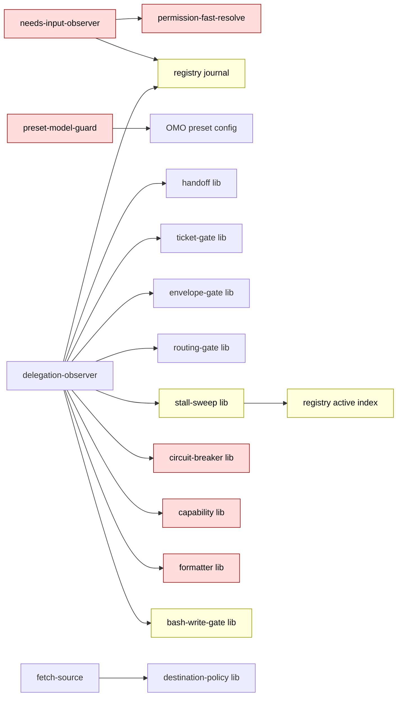

# OpenCode V1 -> V2: Keep, Simplify, Port, or Delete

<!-- ANALYZER-OUTPUT-CONTRACT
schema-version: 1.0
agent: analyzer
claim-type: recommendation
evidence-source: knowledge/res-261112-1ima-opencode-version-migration/res-261112-1ima-opencode-version-migration-conspect.md
confidence: Medium
shelf-registration: memory-shelf.yaml (shelf.analyses), delegated to memory-manager
-->

Campaign ticket: DIA-261112-exon. Scope: analysis only. Inputs read: the
version-migration conspect (684 lines, 94 citations), `opencode.jsonc`,
`oh-my-opencode-slim.jsonc`, `tui.json`, `.mise.toml`, `Dockerfile.dev`, all
three project plugins, all 14 `lib/` modules, both typed tools, 35 plugin test
files, and the structure/pin gates. No shell was used.

Confidence is Medium, not High: the DELETE/SIMPLIFY calls are grounded in
measured repo evidence, but the PORT cost of every gate depends on V2
behaviour the conspect does not establish (notably whether `task()` arguments
are visible and mutable in `ctx.tool.hook("execute.before")`). Those items are
in the probe list (section F.iii), not assumed.

Legend for evidence anchors: `DO` = `.opencode/plugins/delegation-observer.ts`,
`NI` = `.opencode/plugins/needs-input-observer.ts`, `PMG` =
`.opencode/plugins/preset-model-guard.ts`, `CON` = the migration conspect,
section number. All line counts below were measured by reading the files.

Scoring key (all criteria 1-5):

| Criterion | 1 | 5 |
|---|---|---|
| Unique value | process/judgment replaces it | only mechanism for the job |
| V2 redundancy | no V2-native capability established (UNVERIFIED) | V2 natively does the job |
| Port cost | under 50 LOC / one hook | multi-surface rewrite with unknown V2 semantics |
| Risk if wrong | cosmetic | campaign or audit integrity |
| Test debt released | none | over 700 test lines |

Higher Unique and Risk argue for keeping; higher V2 redundancy, Port cost and
Test debt argue for removing. Verdicts are judgment, not a formula.

## A. Verdict

Delete roughly two-fifths of the custom plugin surface before porting
anything. Measured: **3,966 of 10,321 authored plugin LOC (38%) can be deleted
outright; another 1,387 LOC (13%) can be shrunk instead of rewritten, so 5,353
LOC (52%) never needs a V2 adaptation.** That removes 19 of 35 bun test suites
(7,221 of 15,952 lines, 45%), one bats suite (198 lines) plus its 91-line
renderer, 9 of 14 hook call sites (64%), two of the three plugin files, four of
14 lib modules outright with three more shrunk, and `mint_capability`. Of 34
distinct components: **16 DELETE, 5 SIMPLIFY, 10 PORT, 1 PORT-LAST, 2
KEEP-AS-IS**. The developer's instinct is right: `needs-input-observer` is the
single biggest kill (1,728 LOC, 2,621 test lines, plus 216 LOC of its
fast-resolve lib, seven hook sites). What survives is the integrity layer:
registry/messages journal, handoff seam, ticket gate, reviewer envelope,
routing gate, `log_decision`, `fetch-source`, and the rewritten permission
config.

## B. Rated matrix

Rows are sorted DELETE -> SIMPLIFY -> PORT -> PORT-LAST -> KEEP-AS-IS. Three
rows are lib-level views of a component row already counted (`1`/`16a`,
`5`/`16f`, `7a`/`16e`); the distinct-artifact totals in section A count each
pair once. Test-debt scores are group attributions: rows 14a/14b/14c share
the six needs-input suites, and rows 8/16b share the circuit-breaker suite.
Do not sum the Test-debt column across rows; the ledger in section D carries
the de-duplicated totals.

| # | Component | Unique | V2 redund. | Port cost | Risk | Test debt | Verdict | Evidence and one-line justification |
|---|---|---|---|---|---|---|---|---|
| 7b | Adaptive routing state (EMA, idempotency, per-agent health) | 2 | 1 (UNVERIFIED) | 4 | 2 | 1 | DELETE | DO:1164-1449, state path :1169. Self-tuning heuristic with no measured outcome; duplicate-dispatch block also fires on legitimate retries. |
| 8 | Apoptosis + tool circuit breaker + paracrine signals | 2 | 2 | 4 | 3 | 5 | DELETE | DO:897-979, 2013-2032, 3226-3235; lib/circuit-breaker.ts:8-10. V2 has session error lifecycles and `cancel_task`; the auto-kill path is a second, opaque policy layer. 1,326 test lines ride on it. |
| 9 | A1 parallel-batch advisory | 1 | 1 (UNVERIFIED) | 1 | 1 | 1 | DELETE | DO:1783-1805, 1976-2005. Warn-only, no block, no test suite; the orchestrator dispatch contract already encodes the safe patterns. |
| 10a | Empty-result detection (DIA-224 / DIA-260926-ch1d) | 2 | 1 (UNVERIFIED) | 2 | 2 | 3 | DELETE | DO:3306-3410. Predicate history includes a 99.2% false-positive class (DO:3313-3318); orchestrator review of child output is the real check. |
| 10b | Failure cap for consecutive empty results | 1 | 1 (UNVERIFIED) | 1 | 1 | 2 | DELETE | DO:583-594, 3366-3401. Warning-only counter layered on 10a; dies with 10a. |
| 11 | Context velocity + adaptive session-compaction policy | 2 | 3 | 2 | 2 | 3 | DELETE | DO:1635-1776, 4108-4145. Native `compaction.auto` exists (opencode.jsonc:18-22); 60/85% warnings are advisory and the nature of the measured signal is already surfaced by `context_usage`. |
| 13b | `mint_capability` tool + bypass plumbing | 1 | 1 (UNVERIFIED) | 1 | 2 | 2 | DELETE | DO:4185-4210, 2069-2106; lib/capability.ts:52-74. The `scripts/tickets new` procedural carve-out (DO:2108-2151) already covers the chicken-and-egg case; a signed 5-minute gate bypass is avoidable surface. |
| 14a | Needs-input ticker state machine and `ticker.json` | 2 | 2 | 3 | 2 | 4 | DELETE | NI:262-264, 728-753, 1515-1606. Cross-session waiting list is useful, but V2's native session list/status replaces the read side; `scripts/ticker-render.sh:1-91` is a second renderer. |
| 14b | Permission watchdog and auto-reject | 2 | 2 | 3 | 3 | 5 | DELETE | NI:356-536. Auto-rejecting a live permission after 5 minutes can fail a session; the verdict is a policy decision a human should make. |
| 14c | Toast and word-pair title notification | 1 | 2 | 3 | 1 | 4 | DELETE | NI:78-129, 978-1090, 1198-1236. Cosmetic WSL/PowerShell path plus 200-word name generator and boot retro-rename pass. |
| 15 | `preset-model-guard` | 1 | 4 | 2 | 1 | 3 | DELETE | PMG:28, 212-252. Re-reads an env preset to switch a newborn model; V2 model selection is config (`provider/model#variant`, CON 3.1). The guard's own header says real `--model` sessions cannot be exempted, so it can clobber a deliberate choice. Zero script or Makefile references (grep). Prior analysis already flagged two of its suites as dead surface: `knowledge/ana-261023-07sa-omo-slim-dead-test-surface/ana-261023-07sa-omo-slim-dead-test-surface-report.md:110-111`. |
| 16b | lib/circuit-breaker + lib/permission-fast-resolve | 1 | 1 (UNVERIFIED) | 1 | 2 | 3 | DELETE | lib/circuit-breaker.ts:32-129; lib/permission-fast-resolve.ts:54-202. Both exist only for rows 8 and 14b. |
| 16c | Edit-time formatter (DIA-105) | 1 | 1 (UNVERIFIED) | 1 | 1 | 3 | DELETE | lib/formatter.ts:18-29, 127-235; DO:2729-2757. The commit-time husky/lint-staged gate remains authoritative (DO:258-263); this only reduces formatting diff noise. |
| 16d | lib/capability | 1 | 1 (UNVERIFIED) | 1 | 2 | 2 | DELETE | lib/capability.ts:26-118. Dies with `mint_capability`; the HMAC secret is process-scoped, so it protects nothing across restarts. |
| 17a | Test suites that die with deleted code | 1 | 1 (UNVERIFIED) | 1 | 1 | 5 | DELETE | 19 bun suites, 7,221 lines, plus `scripts/__tests__/ticker-render.bats` (198 lines). Exact list in section D. |
| 18c | Ollama provider block | 1 | 5 | 1 | 1 | 0 | DELETE | opencode.jsonc:764-798. Three local models, none referenced by any preset in `oh-my-opencode-slim.jsonc`; V2 would need `providers`/`package`/`settings` migration for an unused path. |
| 1 | Registry/journal persistence | 5 | 1 (UNVERIFIED) | 3 | 5 | 2 | SIMPLIFY | DO:394-400; lib/registry.ts:450-1209. Keep append-only `registry.jsonl`/`messages.jsonl`/`boot.json`; drop the operator rotation, diagnostics, active lifecycle index and cross-process compare machinery. |
| 5 | Bash write tripwire (coder-only) | 3 | 3 | 2 | 3 | 2 | SIMPLIFY | DO:2363-2415; lib/bash-write-gate.ts:26-55. The gate itself admits it is not a boundary (lib:10-13). Keep the protected-literal check; drop the 10 command-form parsers to a 3-form minimum (redirection, tee, in-place edit), or map to V2 `shell` permission denies where possible. |
| 10c | Stall sweep | 3 | 1 (UNVERIFIED) | 3 | 3 | 4 | SIMPLIFY | lib/stall-sweep.ts:124-347; DO:459-479. Real capability (hung sessions do not always emit an error), but the 349-line DI/timeout/journal implementation can be a 60-line tail-read sweep. Keep the capability, kill the active-index dependency. |
| 13c | `context_usage` tool | 3 | 2 | 2 | 3 | 2 | SIMPLIFY | DO:3918-4177. The direct token read is the orchestrator's only programmatic context signal; keep it plus threshold flags. Drop velocity alerting, council attribution, credit estimates and the proxy fallback. |
| 16a | lib/registry active lifecycle index (lib view of row 1) | 5 | 1 (UNVERIFIED) | 4 | 5 | 4 | SIMPLIFY | lib/registry.ts:197-332, 560-640, 1002-1064. Exists to serve the stall sweep; with 10c simplified it is removable. This is the highest-leverage shrink in the tree. |
| 16f | lib/bash-write-gate (lib view of row 5) | 3 | 3 | 2 | 3 | 2 | SIMPLIFY | lib/bash-write-gate.ts:1-289. Same artifact as row 5; keep redirection and `tee`, drop `dd`/`sed`/`sort`/`uniq`/`curl`/`wget`/`trafilatura`/`crwl` forms. |
| 18e | Council seats | 2 | 5 | 1 | 2 | 0 | SIMPLIFY | oh-my-opencode-slim.jsonc:330-359. Five seats across two providers; reduce to two opencode-go seats, drop the github-copilot dependency unless council is actively used. |
| 2 | Handoff seam (slot + pointer + archive + checksum) | 5 | 1 (UNVERIFIED) | 3 | 5 | 3 | PORT | lib/handoff.ts:30-203; DO:3642-3896. The DIA-124 hard rule and DIA-085 parallel-slot semantics depend on it; no V2 equivalent. Transliterate, do not redesign. |
| 3 | Ticket gate (DIA-217/063) | 5 | 1 (UNVERIFIED) | 2 | 5 | 4 | PORT | DO:2048-2272; lib/ticket-gate.ts:130-351. Pure policy, no V2 concept; maps to `execute.before` if task args are visible. |
| 4 | Reviewer FIXED_POINT envelope + duplication guard | 5 | 1 (UNVERIFIED) | 3 | 4 | 3 | PORT | DO:1829-1975; lib/envelope-gate.ts:20-37. Reviewer is bash-denied by config, so the envelope is its only diff evidence; V2 provides no substitute. |
| 6 | Protected-path edit gate + gate token | 4 | 3 | 2 | 4 | 1 | PORT | DO:2274-2361, 2695-2723. V2 edit permissions can deny `.opencode/**` paths, but the ai-specialist token is a workflow gate with no native equivalent. |
| 7a | Routing gate (DIA-230) | 3 | 1 (UNVERIFIED) | 1 | 3 | 1 | PORT | DO:2470-2519; lib/routing-gate.ts:118-151. Small, cheap, enforces AGENTS.md section 2.5 ordering; overlaps the ticket gate but not fully. |
| 13a | `log_decision` tool | 5 | 1 (UNVERIFIED) | 2 | 5 | 0 | PORT | DO:3551-3899. It is both the semantic log writer and the only handoff-slot writer; losing it breaks DIA-124. |
| 16e | lib/routing-gate (lib view of row 7a) | 3 | 1 (UNVERIFIED) | 1 | 3 | 1 | PORT | lib/routing-gate.ts:1-152. Keep as one file; shared with the node test. |
| 16g | lib/ticket-gate + handoff + envelope-gate + destination-policy + errors | 5 | 1 (UNVERIFIED) | 3 | 5 | 3 | PORT | lib/ticket-gate.ts:130-351; lib/handoff.ts:30-203; lib/envelope-gate.ts:20-37; lib/destination-policy.ts:41-102; lib/errors.ts:36-97. These are the pure seams the gates and fetch tool depend on; eight libs are gate-enforced by `scripts/validate-plugin-structure.sh:30-40`. |
| 17b | Test suites that must port or be rewritten | 5 | 1 (UNVERIFIED) | 4 | 4 | 0 | PORT | 16 bun suites, 8,731 lines. They encode edge cases earned by DIA failure history; rewrite only after the probe. |
| 18b | Per-agent permission blocks | 5 | 3 | 5 | 5 | 0 | PORT | opencode.jsonc:177-758; CON 3.1 and 4.3. The single largest and most dangerous migration: V1 `permission` objects become ordered V2 `permissions` arrays, `bash`->`shell`, `task`->`subagent`, `write`/`patch`->`edit`. A half-migration fails open silently. |
| 19 | `fetch-source` + destination policy | 5 | 1 (UNVERIFIED) | 3 | 4 | 0 | PORT | tools/fetch-source.ts:138-150; lib/destination-policy.ts:41-102. Researcher has no shell (`opencode.jsonc:591`), so this is its only source-capture path; the `context.agent` guard is the real control. |
| 12 | Compaction snapshot injection | 3 | 2 | 1 | 2 | 0 | PORT-LAST | DO:3525-3542; NI:1691-1706. Maps cleanly to `ctx.session.hook("compaction")`, but it is only useful after the journal and handoff survive. |
| 18a | 12+ envsitter denies | 4 | 2 | 1 | 3 | 0 | KEEP-AS-IS | opencode.jsonc:184-191, 738-752. Tool-name denies survive the action rename; cheap secret-file protection. |
| 18d | Two MCP servers (`context7`, `gh_grep`) | 3 | 5 | 1 | 2 | 0 | KEEP-AS-IS | opencode.jsonc:841-858. V2 renames the container to `mcp.servers`, but the capability is wanted and the config change is mechanical. |

## C. Delete before you migrate (ordered kill list)

Ordered safest-first: each entry is independently revertible and none is a
prerequisite for the later ones. The "lost" line is the honest cost.

| Order | Kill | Reason it is expendable | Capability lost |
|---|---|---|---|
| 1 | `preset-model-guard.ts` + 3 suites | Zero production references outside tests/openspec; duplicates model selection that V2 config already expresses; its own header admits it cannot exempt a real `--model` choice | Env-preset enforcement at `session.created`; a manual `OH_MY_OPENCODE_SLIM_PRESET` mismatch will no longer be auto-corrected |
| 2 | A1 batch advisory (DO:1976-2005) | Warn-only, no block, no suite; the dispatch contract already lists safe patterns | A log line when an unsafe parallel batch is assembled |
| 3 | Context velocity + adaptive compaction policy (DO:1635-1776) | Advisory only; native compaction config remains; threshold logic is duplicated by `context_usage` | 60% and 85% warnings; post-compaction "start a new session" nudge |
| 4 | Edit-time formatter (DO:2729-2757 + lib) | Commit-time lint-staged is authoritative; formatter failures already non-fatal | Formatting debt becomes visible at commit instead of edit time |
| 5 | Empty-result detection + failure cap (DO:3306-3401) | History of 99.2% false positives; needs-input/manual review is the real check | Automatic flag when a child returns an empty result body; consecutive-failure counter |
| 6 | Adaptive routing state (DO:1164-1449) | Heuristic health/EMA layer with no measured benefit; duplicate-dispatch block can reject legitimate retries | Idempotency dedupe, per-agent EMA, OPEN-agent probe cooldown |
| 7 | Apoptosis + circuit breaker + paracrine (DO:897-979, 2013-2032, 3226-3235 + lib) | Three interacting heuristics; V2 session errors and `cancel_task` cover the real need | Auto-termination of a runaway session, apoptosis handoff, state signals (`build.passed`, `tests.failed`, etc.) |
| 8 | `mint_capability` + lib/capability (DO:4185-4210 + lib) | The procedural `scripts/tickets new` carve-out already resolves the deadlock; signed bypass is avoidable attack surface | Short-lived signed bypass for bootstrap/ai-infra-application dispatches; those now need a real OPEN ticket or the strict carve-out |
| 9 | `needs-input-observer.ts` + fast-resolve lib (NI:1-1728 + lib:1-216) | Developer-named candidate; 1,728 LOC for notifications, a second state file, and an auto-reject policy; seven hook sites | Cross-session "who is waiting" ticker and toasts; word-pair terminal titles; 5-minute auto-reject; unattended fast-resolve. This is a real operational loss in parallel worktree sessions |
| 10 | Config dead weight: `lsp: true`, `compaction.prune`, `ai-specialist.temperature`, ollama provider, 3 council seats | V2 does not run LSP (CON 5); `prune` is ignored in V2 (CON 3.1); agent temperature is not sent (CON 3.1); ollama is unreferenced; copilot seats add a provider dependency | Local LSP diagnostics (already gone in V2), unused local models, three council voices, one tuning knob that never worked in V2 |

Not on the kill list: registry, handoff, ticket gate, reviewer envelope,
protected-path gate, routing gate, `log_decision`, `fetch-source`,
`get-my-session-id`, and the per-agent permission rules. Those are load-bearing
(see section E and the inversion in section H).

## D. Savings ledger

Measured authored plugin LOC: `delegation-observer.ts` 4,248 +
`needs-input-observer.ts` 1,728 + `preset-model-guard.ts` 275 + 14 lib modules
3,827 + tools 243 = **10,321 lines**. (The brief said 15 lib files; the
directory holds 14 `.ts` modules plus `.scratch/`. The brief said 34 test
suites; 35 `*.test.mjs` files are present. Both discrepancies are in the
appendix.)

Deleted outright, with line attribution:

| Artifact | LOC |
|---|---:|
| `needs-input-observer.ts` (whole) | 1,728 |
| `preset-model-guard.ts` (whole) | 275 |
| `lib/circuit-breaker.ts` | 135 |
| `lib/permission-fast-resolve.ts` | 216 |
| `lib/formatter.ts` | 258 |
| `lib/capability.ts` | 136 |
| DO adaptive-routing section | 286 |
| DO apoptosis/circuit/paracrine glue | 317 |
| DO A1 advisory | 105 |
| DO empty-result + failure-cap | 190 |
| DO context policy + velocity | 240 |
| DO mint-capability branches | 40 |
| DO formatter integration | 40 |
| **Total deleted** | **3,966 (38%)** |

Shrunk rather than deleted: registry 1,209 -> ~350 (-859), stall-sweep 349 ->
~100 (-249), bash-write-gate 289 -> ~150 (-139), `context_usage` tool 260 ->
~120 (-140). **Shrink total 1,387 (13%). Grand total 5,353 of 10,321 = 52%.**

| Verdict | Distinct components | Authored LOC removed | Bun suites removed | Test lines removed | Config keys removed | Hook sites removed | Tools removed |
|---|---:|---:|---:|---:|---:|---:|---:|
| DELETE | 16 | 3,966 | 19 | 7,221 | 10 | 9 | 1 |
| SIMPLIFY | 5 | 1,387 (shrink) | 0 (2 rewritten) | 0 | 0 | 0 | 0 (1 simplified) |
| PORT | 10 | 0 | 0 | 0 | 0 | 0 | 0 |
| PORT-LAST | 1 | 0 | 0 | 0 | 0 | 0 | 0 |
| KEEP-AS-IS | 2 | 0 | 0 | 0 | 0 | 0 | 0 |
| **Total** | **34** | **5,353 / 10,321 (52%)** | **19 / 35 (54%)** | **7,221 / 15,952 (45%)** | **10** | **9 / 14 (64%)** | **1 / 5** |

Collateral outside the bun suite: `scripts/ticker-render.sh` (91 lines) and
`scripts/__tests__/ticker-render.bats` (198 lines) die with the ticker;
`scripts/verify-pre-push.sh:170` and `scripts/__tests__/verify-pre-push.bats:194,199,378`
reference the needs-input suite and must be edited; `scripts/__tests__/batch-d-infra.test.mjs:655`
lists `needs-input-observer.ts` in a file manifest.

Suites deleted (19): preset-model-guard t1/t3/t5 (451), needs-input dia189 /
fast-resolve / per-permission-rows / platform-gate / reload-dedup /
ticker-expiry (2,621), adaptive-session-compaction (286), context-velocity
(230), empty-result-detection (471), failure-cap (200), dia220-apoptosis (839),
circuit-breaker (487), formatter (726), capability-tokens (215), capability
(354), active-lifecycle-index (341).

Suites ported or rewritten (16, 8,731 lines): registry 2,065; handoff 624;
parallel-handoff 777; handoff-archive 199; handoff-slot-identity 205;
dia217-ticket-gate 731; ticket-gate 694; dia-ticket-id-parser 201;
reviewer-envelope 791; integration-regressions 375; stall-sweep 951 (rewrite);
delegation stale-boot 292 (rewrite); delegation reload-dedup 190 (rewrite);
bash-write-tripwire 303 (rewrite); plugin-load-smoke 193;
plugin-harness.mock-child-process 140.

Hook sites removed (9 of 14): NI `tool.execute.before`, `tool.execute.after`,
`chat.message`, `experimental.compaction.autocontinue`, `event`,
`experimental.session.compacting`, `dispose` (7); PMG `event` (1); DO
`experimental.compaction.autocontinue` (1). Remaining: DO `execute.before`,
`execute.after`, `event`, `session.compacting`, setup cleanup (5).

Config keys removed (10): ollama provider (1) + three models (3); `lsp` (1);
`compaction.prune` (1); `ai-specialist.temperature` (1); three council seats
(3).

## E. What must survive, and where it maps in V2

| Must survive | Why (load-bearing) | V2 surface |
|---|---|---|
| Registry + messages journal (simplified) | The audit trail for every delegation and decision; scripts, ticket attribution and `jsonl-stats` read it; no native equivalent | `ctx.event.subscribe()` for lifecycle + direct `fs` append; V2 plugin storage is id-scoped but is not a journal |
| Handoff slot + pointer + archive + checksum | DIA-124 hard rule (handoff before final summary); DIA-085 parallel slots; no V2 equivalent | `ctx.tool.transform` (`log_decision`) + `fs`; cleanup returned from `setup` |
| `log_decision` tool | Only writer of the handoff slot and the semantic event log | `ctx.tool.transform((e) => e.add({ name, input: JSON Schema, execute }))` |
| Ticket gate DIA-217/063 | No V2 ticket concept; forces an OPEN DIA ticket on every `task()` | `ctx.tool.hook("execute.before")` on `task` (requires task-arg visibility, probe P1) |
| Reviewer FIXED_POINT envelope + duplication guard | Reviewer is bash-denied by config; the injected range is its only evidence | Same `execute.before` hook plus prompt mutation (probe P1) |
| Protected-path edit gate + gate token | Mechanical enforcement of AGENTS.md section 2.5 | `execute.before` on edit/write/patch; V2 `edit` permission denies `.opencode/**` as a second layer |
| Routing gate DIA-230 | Enforces ai-specialist review before coder config work | `execute.before` (small, same hook) |
| `fetch-source` + destination policy | Researcher has no shell; this is the only archive path | `ctx.tool.transform`; `execute` context must still expose agent identity (probe P3) |
| `get-my-session-id` | Populates `parent_session_id` and ticket frontmatter | `ctx.tool.transform`; `ctx.location` / tool context |
| Per-agent permission blocks | The security boundary for every lane | V2 ordered `permissions` arrays (CON 3.1, 4.3) |
| MCP servers + envsitter denies | Research tooling and secret-file protection | `mcp.servers`; tool-name denies unchanged |
| Compaction snapshot (last) | Keeps active delegations visible across compaction | `ctx.session.hook("compaction")` (injection shape probe P6) |

## F. Blockers

### (i) Blockers that exist today, before migration

| # | Blocker | Evidence | Consequence |
|---|---|---|---|
| B1 | Host/container OpenCode pin split: 1.18.32 vs 2.2.6 | `.mise.toml:12`; `Dockerfile.dev:30`; `scripts/check-pin-sync.sh:102` | `check-pin-sync.sh` compares them as one identity and fails now. |
| B2 | OMO pins disagree three ways: 2.2.19 / 2.2.19 / 3.0.7 | `opencode.jsonc:817`; `tui.json:2`; `Dockerfile.dev:33`; `scripts/check-omo-version-sync.sh:34` | Version-sync gate fails now; the image cache may pre-install a different OMO than the runtime resolves. |
| B3 | Ponytail is unpinned | `opencode.jsonc:822` | Floats to latest; a V2-breaking plugin release can land without a diff. |
| B4 | Plugin SDK split: 1.17.7 in the project vs 1.18.13 pinned by OMO | `.opencode/package.json:3`; `Dockerfile.dev:287` | Type and runtime shapes diverge; a local typecheck proves little about the container runtime. |
| B5 | The OpenCode install RUN block is malformed | `Dockerfile.dev:279-280` (line 280 begins with a literal `+`) | The image build command block is not valid shell as written; rebuild will fail or silently skip the version check. |
| B6 | Project-local TUI config will not migrate | `tui.json:1-3`; CON 6 step 4 | V2 client config is a single global `cli.json`; project-local `tui.json` is not migrated, so the OMO pin declared there is lost. |
| B7 | The container pin may already be V2 | `Dockerfile.dev:30` (2.2.6) vs V1 plugin code | If the image really runs 2.2.6, the current V1 plugins cannot load at all. Either the pin is stale or the container is already broken; this is the first thing to verify. |

### (ii) Blockers that only appear at V2

| # | Blocker | Evidence | Consequence |
|---|---|---|---|
| B8 | Permission half-migration fails open silently | CON 3.1, 4.3; `opencode.jsonc:29-138` and per-agent blocks | Renamed actions (`bash`->`shell`, `task`->`subagent`, `write`/`patch`->`edit`) written in V2 syntax never match, and lost rules fall through to base allow. This is the single biggest blocker. |
| B9 | Plugin entry and package import rewrite | CON 2, 2.1 | Two plain async factories and one object entrypoint become `Plugin.define({ id, setup(ctx) })`; `@opencode-ai/plugin` -> `@opencode/plugin`. |
| B10 | Hook rewrites | CON 2.2, 2.3 | `execute.before`/`after` -> `ctx.tool.hook`; `event` -> `ctx.event.subscribe`; `compacting` -> `ctx.session.hook("compaction")`; `autocontinue` has NO equivalent. |
| B11 | Tool registration rewrite | CON 2.1 | Five `tool()` registrations become `ctx.tool.transform(...).add(...)` with JSON Schema input and structured output. |
| B12 | Config renames and the nested-mixing rule | CON 3.1, 3.2 | `plugin`->`plugins`, `agent`->`agents`, `provider`->`providers`, `mcp`->`mcp.servers`, `permission`->`permissions`; each agent/provider entry must be entirely one format. |
| B13 | Local plugin discovery may skip file entrypoints | CON 2.4 | Local plugin paths must be directories; `./plugin/local.ts` is skipped. Whether auto-discovered `.opencode/plugins/*.ts` files are still loaded is not established (probe P4). |
| B14 | LSP runtime removed | CON 5; `opencode.jsonc:141` | `lsp: true` is preserved but inert; delete it rather than migrate it. |
| B15 | Compaction keys changed or ignored | CON 3.1; `opencode.jsonc:18-22` | `reserved` -> `buffer`; `prune`/`tail_turns` have no V2 equivalent and are ignored with a warning. |
| B16 | `session.compacted` event removed | CON 5 (v2.1.0); DO:640 seeds on it | Any surviving context policy must use `session.compaction.started`/`ended` instead. The policy is deleted here, which removes the issue. |
| B17 | `disabled_agents` is UNVERIFIED in V2 | CON 7 item 4; `oh-my-opencode-slim.jsonc:5` | OMO's disabled-alias guard may not exist in V2; do not assume it survives. |
| B18 | V2 client config is global only | CON 6 step 4 | Project-local `tui.json` is not migrated; hand-port or drop the pin. |

### (iii) UNVERIFIED items that need a probe before a port decision

| # | Probe | Why it gates the design |
|---|---|---|
| P1 | Does `ctx.tool.hook("execute.before")` expose the `task()` args (`subagent_type`, `description`, `prompt`) and allow in-place mutation of `prompt` before spawn? | Ticket gate, reviewer envelope, routing gate and A1 all depend on this. If not, all four need a different mechanism or die. |
| P2 | Does `execute.before` run before permission evaluation for the target tool? | The gates currently rely on firing before the tool body. A permission prompt before the gate would leak an unguarded dispatch. |
| P3 | Does the tool `execute` context still carry `agent`, `sessionID`, `directory`, `abort`? | `fetch-source`'s agent guard, `log_decision`'s slot identity and `get-my-session-id` all depend on it. |
| P4 | Are top-level `.opencode/plugins/*.ts` files auto-discovered in V2, or must each be a directory with an index entrypoint? | Determines whether the three plugins can stay where they are or need a filesystem restructure. |
| P5 | Which event names and payload shapes survive (`session.idle`, `session.error`, `session.status`, permission/question events)? | The registry lifecycle writer and any notification logic depend on them. |
| P6 | Can `ctx.session.hook("compaction")` inject text into the compaction context the way V1 `output.context.push` does? | Decides whether the compaction snapshot is portable. |
| P7 | Is there a V2-native programmatic context-usage read? | If yes, `context_usage` can be dropped rather than simplified. |
| P8 | Is OMO 3.0.7 V2-compatible, and can 2.2.19 run under V2? | If 2.2.19 cannot, the config pin, the TUI pin and the image pin must move together before any plugin work. |
| P9 | Does V2 keep the stored-permission model and the `ask` fallback exactly as documented? | The permission rewrite is the highest-risk item; verify effective rule order empirically, not from docs alone (CON 7 item 10). |
| P10 | Does `ctx.tool.transform(...).add(...)` support early disposal and per-tool metadata? | Needed for `mint_capability` removal and tool lifecycle. |

## G. Recommended sequence

| Phase | Action | Reversible? | Gate |
|---|---|---|---|
| 0 | Snapshot `.opencode/`, `opencode.jsonc`, `tui.json`, plugins (CON 6 step 1). Record ADR-001/002/003 and the DIA histories for any deleted component in memory. | Yes | memory-manager |
| 1 | Delete the self-contained tier: preset guard, A1, context policy/velocity, formatter, empty-result + failure cap, adaptive routing. Remove their suites. | Yes (git revert) | `make test-config`, `make test-harness` after suite edits |
| 2 | Delete needs-input observer, its fast-resolve lib and six suites; remove `ticker-render.sh` + bats; edit `verify-pre-push.sh:170` and its bats assertions; update `batch-d-infra.test.mjs:655`. | Yes | shell + harness suites |
| 3 | Simplify registry (drop active index/rotation/diagnostics), stall sweep (tail-read version), bash tripwire (three forms), `context_usage` (direct read only). Rewrite their tests. | Yes | `make test-harness` |
| 4 | Delete config dead weight: ollama, `lsp`, `compaction.prune`, agent temperature, three council seats. | Yes | `make test-config` |
| 5 | Probe P1-P10 in a disposable V2 install. Do not port a gate before P1/P2 result. | N/A | probe report |
| 6 | Port permissions first (security), then `log_decision` + handoff, ticket gate, reviewer envelope, simplified registry, routing gate, `fetch-source`, `get-my-session-id`, compaction snapshot last. | No (V1 path removed) | full gates + V2 smoke |

Delete now, in this order: phases 1 and 2 are cheap and reversible and remove
the majority of the V2 surface area. Phase 3 is the highest-leverage shrink
because it removes the registry active index, but it needs a test rewrite, so
do it after the pure deletions. Do not start phase 6 until P1 and P2 are
answered; a gate that silently stops firing is worse than a gate that is
temporarily absent, because the absence is visible in review.

## H. Inversion: what breaks if we delete too aggressively

The opposite case is not "everything is fine"; it is that several classes of
failure become silent.

1. **The audit trail is load-bearing, and it is not just logs.** Deleting the
   registry would not visibly break a session; it would break ticket
   attribution, `jsonl-stats`, the handoff checksum proof and every script
   that reconstructs what happened. That is why registry and handoff are
   SIMPLIFY/PORT, never DELETE.
2. **The three gates are the only mechanical enforcement of the campaign's
   process.** Ticket gate, reviewer envelope and routing gate each encode
   failure history: weak-correlation false positives, the meta-task deadlock,
   the duplicate-envelope injection bug, the reviewer-with-no-bash problem.
   A from-scratch rewrite will re-open those classes. Port them by
   transliteration, not redesign, and keep their tests.
3. **Deleting needs-input has an operational cost in parallel work.** It is
   the only cross-session "who is waiting" signal in the DIA-085 worktree
   model, and its unattended fast-resolve path was deliberately built to stop
   permission stalls from burning a bound. If unattended or overnight runs
   are still part of the workflow, deleting it reintroduces a known failure
   mode. The honest mitigation is to decide the policy first: either accept
   that a human watches the session list, or keep a 50-line "waiting" marker
   and drop only the auto-reject and notification machinery.
4. **Deleting the stall sweep removes the only proactive hang detector.**
   `session.error` and `session.idle` cover normal and failing sessions, but a
   session that is simply stuck emits neither. This is why the verdict is
   SIMPLIFY, not DELETE, and why the simple tail-read version must keep the
   journal lock semantics.
5. **Some knowledge exists only in these plugins and their tests.** The
   registry lifecycle-generation rules, the handoff slot-identity fix
   (DIA-260827-y9n9), the envelope duplication guard (DIA-261023-d6b9) and
   the unattended permission ADRs are not derivable from the surrounding
   docs. Git preserves the code, but not the reasons. Before deleting, write
   the reasons into memory; otherwise a future re-implementation will
   reproduce the same bugs with new ticket numbers.
6. **The config deletion that looks safest is the most dangerous.** Ollama,
   `lsp` and `compaction.prune` are genuinely dead. The per-agent permission
   blocks are not: deleting or half-migrating them turns restrictions into
   base-allow. Verify shell, edit and subagent flows under each affected
   agent and treat any load-time warning as a migration failure (CON 4.3).
7. **What is irreversible.** The V1 plugin API removal and the permission
   rewrite are irreversible in practice (CON 6 step 5). The file deletions are
   reversible in git; the knowledge loss is not. That asymmetry is the reason
   to delete code aggressively and delete tests only after recording what
   they protected.

## Mermaid: deletion cascade

Reading: the red nodes are deleted outright; the yellow nodes survive only in
a reduced form. Deleting `needs-input-observer` takes `permission-fast-resolve`
with it. Deleting the active index depends on simplifying the stall sweep,
which is the single largest structural win after the plugin deletions.

## Appendix: measured discrepancies and evidence index

| Item | Brief said | Measured | Impact |
|---|---|---|---|
| lib modules | 15 | 14 `.ts` modules plus `.scratch/` | One fewer module to rate; no verdict depends on the missing file. |
| plugin test suites | 34 | 35 `*.test.mjs` (15,952 lines) | Math uses 35; if the campaign count excludes the 140-line mock-child-process suite, deleted/ported totals shift by one suite and 140 lines. |
| `Dockerfile.dev` install block | assumed valid | `Dockerfile.dev:280` begins with a literal `+` | Build blocker B5. |
| `lsp` | assumed live | V2 does not run LSP (CON 5) | Dead config, delete. |
| `compaction.prune` | assumed live | no V2 equivalent (CON 3.1) | Ignored with warning, delete. |

Primary evidence files read in full: the conspect (sections 2, 3, 4, 5, 6, 7);
`opencode.jsonc`; `oh-my-opencode-slim.jsonc`; `tui.json`; `.mise.toml`;
`Dockerfile.dev`; all three plugins; all 14 lib modules; both tools; all 35
test-file headers and line counts; `scripts/validate-plugin-structure.sh`;
`scripts/check-pin-sync.sh`; `scripts/check-omo-version-sync.sh`;
`scripts/ticker-render.sh`; `scripts/__tests__/ticker-render.bats`;
`Makefile:388-390`; `scripts/verify-pre-push.sh:170`; and the grep evidence for
`preset-model-guard` (tests/openspec only) and `needs-input-observer` (script
and bats references).
